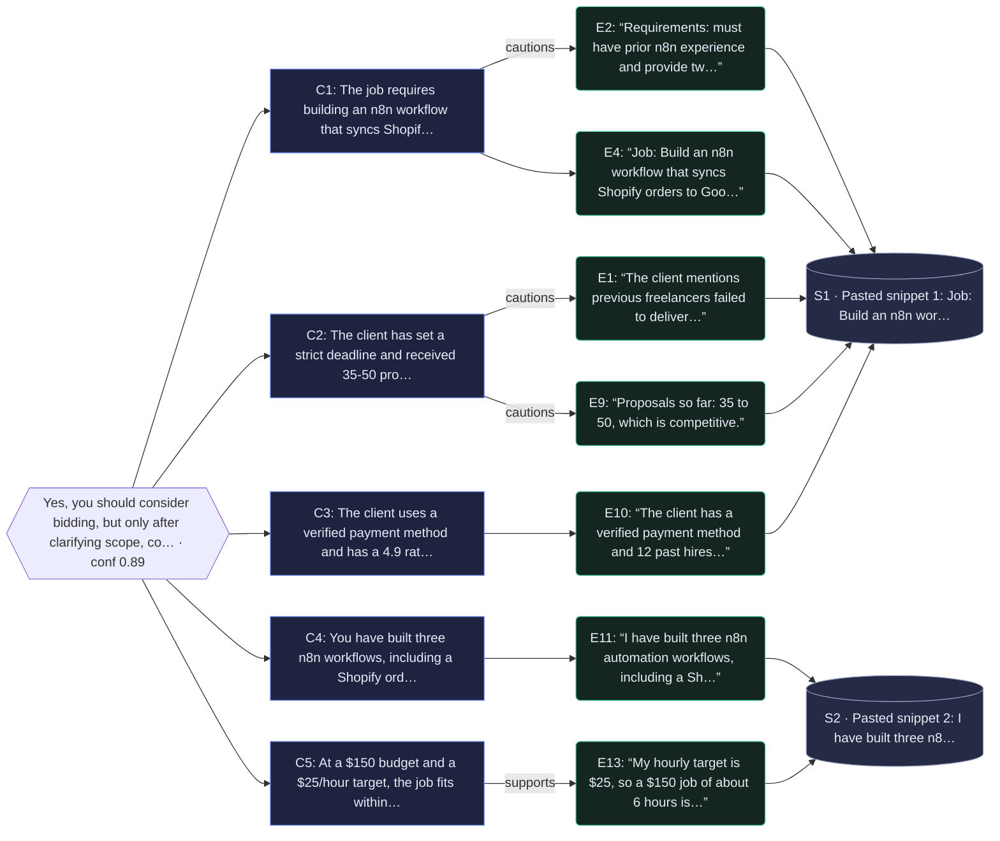

# Evidence Desk report

**Question:** Should I bid on this n8n freelance job?

**Recommendation:** Yes, you should consider bidding, but only after clarifying scope, confirming payment terms, and ensuring the $150 budget aligns with your $25/hour target.

**Confidence:** 0.89 (high) · mode: live · model: nvidia/NVIDIA-Nemotron-3-Nano-30B-A3B

## Why (claims → evidence)
- The job requires building an n8n workflow that syncs Shopify orders to Google Sheets and sends Slack alerts, and the client demands prior n8n experience with portfolio links. [E2] [E4]
- The client has set a strict deadline and received 35‑50 proposals, indicating high competition. [E1] [E9]
- The client uses a verified payment method and has a 4.9 rating from 12 past hires, reducing payment risk. [E10]
- You have built three n8n workflows, including a Shopify order notifier, matching the required experience. [E11]
- At a $150 budget and a $25/hour target, the job fits within a ~6‑hour effort, making it potentially profitable. [E13]

## Why-graph (recommendation → claims → quotes → sources)

5 claim(s) rest on 7 cited quote(s) from 2 source(s); uncited evidence: E3, E5, E6, E7, E8, E12, E14, E15.

## Evidence
- **[E1]** “The client mentions previous freelancers failed to deliver on time, so the deadline is strict.” — [Pasted snippet 1: Job: Build an n8n workflow that syncs Shopify orders to Google Sheets ](pasted:snippet-1) _(for: What specific deliverables and requirements does the client outline for the n8n freelance job?; score 12.76 · matched: client, deliver, freelan)_
- **[E2]** “Requirements: must have prior n8n experience and provide two portfolio links.” — [Pasted snippet 1: Job: Build an n8n workflow that syncs Shopify orders to Google Sheets ](pasted:snippet-1) _(for: What specific deliverables and requirements does the client outline for the n8n freelance job?; score 2.07 · matched: n8n)_
- **[E3]** “As part of the deal n8n's technology is being embedded in SAP's Joule Studio.” — [n8n - Wikipedia](https://en.wikipedia.org/wiki/N8n) _(for: What specific deliverables and requirements does the client outline for the n8n freelance job?; score 1.02 · matched: n8n)_
- **[E4]** “Job: Build an n8n workflow that syncs Shopify orders to Google Sheets and sends a Slack alert.” — [Pasted snippet 1: Job: Build an n8n workflow that syncs Shopify orders to Google Sheets ](pasted:snippet-1) _(for: How much time and resources will be needed to complete the job based on its scope?; score 3.4 · matched: job, n8n)_
- **[E5]** “n8n (pronounced "n-eight-n", a contraction of "nodemation") is a workflow automation platform and the Berlin company, n8n GmbH , that develops it.” — [n8n - Wikipedia](https://en.wikipedia.org/wiki/N8n) _(for: How much time and resources will be needed to complete the job based on its scope?; score 0.64 · matched: n8n)_
- **[E6]** “In March 2020, n8n raised $1.5 million in seed funding co-led by Sequoia Capital and firstminute capital.” — [n8n - Wikipedia](https://en.wikipedia.org/wiki/N8n) _(for: How much time and resources will be needed to complete the job based on its scope?; score 0.46 · matched: n8n)_
- **[E7]** “I have no reviews on this platform yet, which is a risk for winning competitive bids.” — [Pasted snippet 2: I have built three n8n automation workflows, including a Shopify order](pasted:snippet-2) _(for: What is the expected payment amount and how does it compare to the opportunity cost of taking on this project?; score 4.5 · matched: bid)_
- **[E8]** “n8n was founded by Jan Oberhauser in Berlin , and the project launched publicly in October 2019.” — [n8n - Wikipedia](https://en.wikipedia.org/wiki/N8n) _(for: What is the expected payment amount and how does it compare to the opportunity cost of taking on this project?; score 3.92 · matched: n8n, project)_
- **[E9]** “Proposals so far: 35 to 50, which is competitive.” — [Pasted snippet 1: Job: Build an n8n workflow that syncs Shopify orders to Google Sheets ](pasted:snippet-1) _(for: What is the expected payment amount and how does it compare to the opportunity cost of taking on this project?; score 0.53 · matched: (risk/benefit cue))_
- **[E10]** “The client has a verified payment method and 12 past hires with a 4.9 rating.” — [Pasted snippet 1: Job: Build an n8n workflow that syncs Shopify orders to Google Sheets ](pasted:snippet-1) _(for: What risks (e.g., ambiguous requirements, payment delays) are associated with bidding, and how can they be mitigated?; score 3.66 · matched: payment)_
- **[E11]** “I have built three n8n automation workflows, including a Shopify order notifier, and they are on GitHub.” — [Pasted snippet 2: I have built three n8n automation workflows, including a Shopify order](pasted:snippet-2) _(for: What risks (e.g., ambiguous requirements, payment delays) are associated with bidding, and how can they be mitigated?; score 0.74 · matched: n8n)_
- **[E12]** “n8n's source code is publicly available under what the company calls a "fair-code" model.” — [n8n - Wikipedia](https://en.wikipedia.org/wiki/N8n) _(for: What risks (e.g., ambiguous requirements, payment delays) are associated with bidding, and how can they be mitigated?; score 0.51 · matched: n8n)_
- **[E13]** “My hourly target is $25, so a $150 job of about 6 hours is a good fit and profitable.” — [Pasted snippet 2: I have built three n8n automation workflows, including a Shopify order](pasted:snippet-2) _(for: What immediate actions should I take to gather missing details and decide whether to submit a bid?; score 1.69 · matched: job)_
- **[E14]** “From 2022, and more visibly from 2024, n8n reoriented around artificial intelligence .” — [n8n - Wikipedia](https://en.wikipedia.org/wiki/N8n) _(for: What immediate actions should I take to gather missing details and decide whether to submit a bid?; score 0.55 · matched: n8n)_
- **[E15]** “n8n has been positioned in coverage as a flexible, self-hostable alternative to hosted automation services such as Zapier and Make , aimed at more technical users.” — [n8n - Wikipedia](https://en.wikipedia.org/wiki/N8n) _(for: What immediate actions should I take to gather missing details and decide whether to submit a bid?; score 0.43 · matched: n8n)_

## Open risks
- Strict deadline may pressure delivery
- High competition with many proposals
- No client reviews yet, increasing uncertainty
- Potential ambiguity in requirements

## Next actions
1. Message the client to clarify exact deliverables, deadline, and payment schedule
2. Gather and prepare portfolio links demonstrating relevant n8n workflows
3. Estimate time needed and confirm the $150 budget aligns with your rate
4. Submit a concise bid addressing the outlined requirements

## Explain-why trace
1. **plan** — Split the question into 5 sub-questions using LLM planner (nvidia/NVIDIA-Nemotron-3-Nano-30B-A3B).
2. **retrieve** — Collected 3 usable source(s) out of 3 attempted.
3. **extract** — Ranked 41 candidate sentence(s) with BM25 + diversity; picked 15 verbatim quote(s) from 3 source(s), skipped 0 near-duplicate(s); 5/5 sub-questions have support.
4. **synthesize** — Drafted recommendation using LLM synthesizer (nvidia/NVIDIA-Nemotron-3-Nano-30B-A3B).
5. **verify** — Checked citations: 5 claim(s) kept, 0 dropped for missing evidence; 15/15 quotes verified verbatim in source. Confidence 0.89 (high).
6. **conclude** — Final: Yes, you should consider bidding, but only after clarifying scope, confirming payment terms, and ensuring the $150 budget aligns with your $25/hour target.

## Sources
- S1 (snippet, ok): [Pasted snippet 1: Job: Build an n8n workflow that syncs Shopify orders to Google Sheets ](pasted:snippet-1)
- S2 (snippet, ok): [Pasted snippet 2: I have built three n8n automation workflows, including a Shopify order](pasted:snippet-2)
- U1 (url, ok): [n8n - Wikipedia](https://en.wikipedia.org/wiki/N8n)
