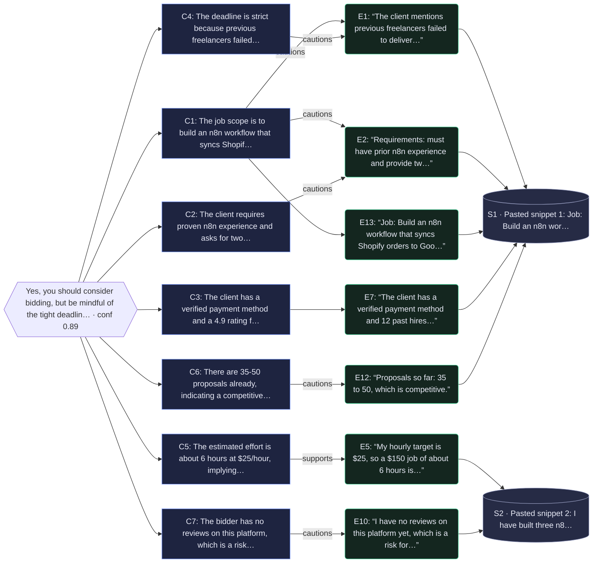

# Evidence Desk report

**Question:** Should I bid on this n8n freelance job?

**Recommendation:** Yes, you should consider bidding, but be mindful of the tight deadline, intense competition, and the need to showcase relevant n8n experience.

**Confidence:** 0.89 (high) · mode: live · model: nvidia/NVIDIA-Nemotron-3-Nano-30B-A3B

**LLM usage (metered):** 2 call(s) · 1013 prompt + 1909 completion tokens · 12820 ms

## Why (claims → evidence)
- The job scope is to build an n8n workflow that syncs Shopify orders to Google Sheets (and may include a Slack alert). [E1] [E2] [E13]
- The client requires proven n8n experience and asks for two portfolio links. [E2]
- The client has a verified payment method and a 4.9 rating from 12 past hires. [E7]
- The deadline is strict because previous freelancers failed to deliver on time. [E1]
- The estimated effort is about 6 hours at $25/hour, implying a $150 compensation. [E5]
- There are 35‑50 proposals already, indicating a competitive bidding environment. [E12]
- The bidder has no reviews on this platform, which is a risk for winning the bid. [E10]

## Why-graph (recommendation → claims → quotes → sources)

7 claim(s) rest on 7 cited quote(s) from 2 source(s); uncited evidence: E3, E4, E6, E8, E9, E11, E14, E15.

## Evidence
- **[E1]** “The client mentions previous freelancers failed to deliver on time, so the deadline is strict.” — [Pasted snippet 1: Job: Build an n8n workflow that syncs Shopify orders to Google Sheets ](pasted:snippet-1) _(for: What is the detailed scope and specific requirements of the n8n freelance job?; score 6.2 · matched: freelan)_
- **[E2]** “Requirements: must have prior n8n experience and provide two portfolio links.” — [Pasted snippet 1: Job: Build an n8n workflow that syncs Shopify orders to Google Sheets ](pasted:snippet-1) _(for: What is the detailed scope and specific requirements of the n8n freelance job?; score 2.07 · matched: n8n)_
- **[E3]** “From 2022, and more visibly from 2024, n8n reoriented around artificial intelligence .” — [n8n - Wikipedia](https://en.wikipedia.org/wiki/N8n) _(for: What is the detailed scope and specific requirements of the n8n freelance job?; score 1.11 · matched: n8n)_
- **[E4]** “n8n was founded by Jan Oberhauser in Berlin , and the project launched publicly in October 2019.” — [n8n - Wikipedia](https://en.wikipedia.org/wiki/N8n) _(for: What is the budget, payment terms, and expected compensation for the project?; score 3.92 · matched: n8n, project)_
- **[E5]** “My hourly target is $25, so a $150 job of about 6 hours is a good fit and profitable.” — [Pasted snippet 2: I have built three n8n automation workflows, including a Shopify order](pasted:snippet-2) _(for: What is the budget, payment terms, and expected compensation for the project?; score 1.69 · matched: job)_
- **[E6]** “n8n's source code is publicly available under what the company calls a "fair-code" model.” — [n8n - Wikipedia](https://en.wikipedia.org/wiki/N8n) _(for: What is the budget, payment terms, and expected compensation for the project?; score 0.51 · matched: n8n)_
- **[E7]** “The client has a verified payment method and 12 past hires with a 4.9 rating.” — [Pasted snippet 1: Job: Build an n8n workflow that syncs Shopify orders to Google Sheets ](pasted:snippet-1) _(for: What is the client's reputation, feedback, and history of timely payments?; score 6.55 · matched: client, payment)_
- **[E8]** “As part of the deal n8n's technology is being embedded in SAP's Joule Studio.” — [n8n - Wikipedia](https://en.wikipedia.org/wiki/N8n) _(for: What is the client's reputation, feedback, and history of timely payments?; score 3.98 · matched: n8n, s)_
- **[E9]** “In May 2026 SAP made a strategic investment reported at more than EUR 60 million for a stake of around 1.3%, valuing n8n at about $5.2 billion and making it, by that measure, Germany's most valuable AI company.” — [n8n - Wikipedia](https://en.wikipedia.org/wiki/N8n) _(for: What is the client's reputation, feedback, and history of timely payments?; score 1.97 · matched: n8n, s)_
- **[E10]** “I have no reviews on this platform yet, which is a risk for winning competitive bids.” — [Pasted snippet 2: I have built three n8n automation workflows, including a Shopify order](pasted:snippet-2) _(for: What are the potential risks or challenges (e.g., scope creep, unclear requirements, payment delays)?; score 4.5 · matched: bid)_
- **[E11]** “n8n (pronounced "n-eight-n", a contraction of "nodemation") is a workflow automation platform and the Berlin company, n8n GmbH , that develops it.” — [n8n - Wikipedia](https://en.wikipedia.org/wiki/N8n) _(for: What are the potential risks or challenges (e.g., scope creep, unclear requirements, payment delays)?; score 0.64 · matched: n8n)_
- **[E12]** “Proposals so far: 35 to 50, which is competitive.” — [Pasted snippet 1: Job: Build an n8n workflow that syncs Shopify orders to Google Sheets ](pasted:snippet-1) _(for: What are the potential risks or challenges (e.g., scope creep, unclear requirements, payment delays)?; score 0.53 · matched: (risk/benefit cue))_
- **[E13]** “Job: Build an n8n workflow that syncs Shopify orders to Google Sheets and sends a Slack alert.” — [Pasted snippet 1: Job: Build an n8n workflow that syncs Shopify orders to Google Sheets ](pasted:snippet-1) _(for: What is the estimated effort, timeline, and required resources to complete the job?; score 3.4 · matched: job, n8n)_
- **[E14]** “I have built three n8n automation workflows, including a Shopify order notifier, and they are on GitHub.” — [Pasted snippet 2: I have built three n8n automation workflows, including a Shopify order](pasted:snippet-2) _(for: What is the estimated effort, timeline, and required resources to complete the job?; score 0.74 · matched: n8n)_
- **[E15]** “In March 2020, n8n raised $1.5 million in seed funding co-led by Sequoia Capital and firstminute capital.” — [n8n - Wikipedia](https://en.wikipedia.org/wiki/N8n) _(for: What is the estimated effort, timeline, and required resources to complete the job?; score 0.46 · matched: n8n)_

## Open risks
- Strict deadline
- High competition (35‑50 proposals)
- No platform reviews for the bidder

## Next actions
1. Prepare and attach two portfolio links demonstrating n8n workflows, especially Shopify‑Google Sheets integrations.
2. Highlight relevant experience in the proposal and confirm understanding of the strict deadline.
3. Propose a realistic timeline (e.g., ~6 hours) and ensure the deliverable meets all listed requirements.
4. Submit a concise, tailored proposal addressing the client’s scope and requirements.

## Explain-why trace
1. **plan** — Split the question into 5 sub-questions using LLM planner (nvidia/NVIDIA-Nemotron-3-Nano-30B-A3B).
2. **retrieve** — Collected 3 usable source(s) out of 3 attempted.
3. **extract** — Ranked 41 candidate sentence(s) with BM25 + diversity; picked 15 verbatim quote(s) from 3 source(s), skipped 0 near-duplicate(s); 5/5 sub-questions have support.
4. **synthesize** — Drafted recommendation using LLM synthesizer (nvidia/NVIDIA-Nemotron-3-Nano-30B-A3B).
5. **verify** — Checked citations: 7 claim(s) kept, 0 dropped for missing evidence; 15/15 quotes verified verbatim in source. Confidence 0.89 (high).
6. **conclude** — Final: Yes, you should consider bidding, but be mindful of the tight deadline, intense competition, and the need to showcase relevant n8n experience.

## Sources
- S1 (snippet, ok): [Pasted snippet 1: Job: Build an n8n workflow that syncs Shopify orders to Google Sheets ](pasted:snippet-1)
- S2 (snippet, ok): [Pasted snippet 2: I have built three n8n automation workflows, including a Shopify order](pasted:snippet-2)
- U1 (url, ok): [n8n - Wikipedia](https://en.wikipedia.org/wiki/N8n)
