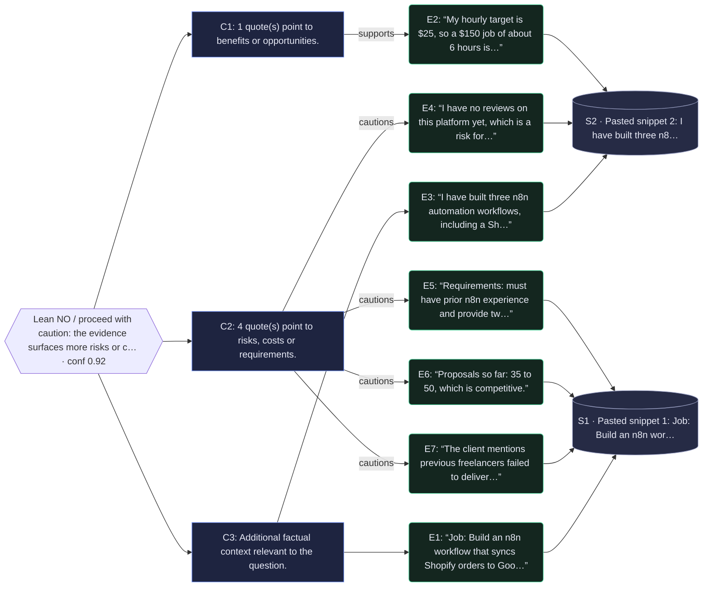

# Evidence Desk report

**Question:** Should I bid on this n8n freelance job?

**Recommendation:** Lean NO / proceed with caution: the evidence surfaces more risks or costs than benefits.

**Confidence:** 0.92 (high) · mode: stub · model: deterministic-stub

## Why (claims → evidence)
- 1 quote(s) point to benefits or opportunities. [E2]
- 4 quote(s) point to risks, costs or requirements. [E4] [E5] [E6] [E7]
- Additional factual context relevant to the question. [E1] [E3]

## Why-graph (recommendation → claims → quotes → sources)

3 claim(s) rest on 7 cited quote(s) from 2 source(s).

## Evidence
- **[E1]** “Job: Build an n8n workflow that syncs Shopify orders to Google Sheets and sends a Slack alert.” — [Pasted snippet 1: Job: Build an n8n workflow that syncs Shopify orders to Google Sheets ](pasted:snippet-1) _(for: What are the key facts about: bid n8n freelance job?; score 2.25 · matched: job, n8n)_
- **[E2]** “My hourly target is $25, so a $150 job of about 6 hours is a good fit and profitable.” — [Pasted snippet 2: I have built three n8n automation workflows, including a Shopify order](pasted:snippet-2) _(for: What benefits or opportunities support: bid n8n freelance job?; score 2.3 · matched: job)_
- **[E3]** “I have built three n8n automation workflows, including a Shopify order notifier, and they are on GitHub.” — [Pasted snippet 2: I have built three n8n automation workflows, including a Shopify order](pasted:snippet-2) _(for: What benefits or opportunities support: bid n8n freelance job?; score 1.13 · matched: n8n)_
- **[E4]** “I have no reviews on this platform yet, which is a risk for winning competitive bids.” — [Pasted snippet 2: I have built three n8n automation workflows, including a Shopify order](pasted:snippet-2) _(for: What risks, costs or requirements count against: bid n8n freelance job?; score 4.56 · matched: bid)_
- **[E5]** “Requirements: must have prior n8n experience and provide two portfolio links.” — [Pasted snippet 1: Job: Build an n8n workflow that syncs Shopify orders to Google Sheets ](pasted:snippet-1) _(for: What risks, costs or requirements count against: bid n8n freelance job?; score 1.97 · matched: n8n)_
- **[E6]** “Proposals so far: 35 to 50, which is competitive.” — [Pasted snippet 1: Job: Build an n8n workflow that syncs Shopify orders to Google Sheets ](pasted:snippet-1) _(for: What risks, costs or requirements count against: bid n8n freelance job?; score 0.53 · matched: (risk/benefit cue))_
- **[E7]** “The client mentions previous freelancers failed to deliver on time, so the deadline is strict.” — [Pasted snippet 1: Job: Build an n8n workflow that syncs Shopify orders to Google Sheets ](pasted:snippet-1) _(for: What should be done next regarding: bid n8n freelance job?; score 2.07 · matched: freelan)_

## Open risks
- I have no reviews on this platform yet, which is a risk for winning competitive bids. [E4]
- Requirements: must have prior n8n experience and provide two portfolio links. [E5]
- Proposals so far: 35 to 50, which is competitive. [E6]
- The client mentions previous freelancers failed to deliver on time, so the deadline is strict. [E7]

## Next actions
1. Verify each cited quote against its source link.
2. Resolve or accept each listed risk before committing.
3. Re-run Evidence Desk with any new information.

## Explain-why trace
1. **plan** — Split the question into 4 sub-questions using deterministic template planner.
2. **retrieve** — Collected 2 usable source(s) out of 2 attempted.
3. **extract** — Ranked 8 candidate sentence(s) with BM25 + diversity; picked 7 verbatim quote(s) from 2 source(s), skipped 0 near-duplicate(s); 4/4 sub-questions have support.
4. **synthesize** — Drafted recommendation using deterministic polarity-weighted synthesizer.
5. **verify** — Checked citations: 3 claim(s) kept, 0 dropped for missing evidence; 7/7 quotes verified verbatim in source. Confidence 0.92 (high).
6. **conclude** — Final: Lean NO / proceed with caution: the evidence surfaces more risks or costs than benefits.

## Sources
- S1 (snippet, ok): [Pasted snippet 1: Job: Build an n8n workflow that syncs Shopify orders to Google Sheets ](pasted:snippet-1)
- S2 (snippet, ok): [Pasted snippet 2: I have built three n8n automation workflows, including a Shopify order](pasted:snippet-2)
